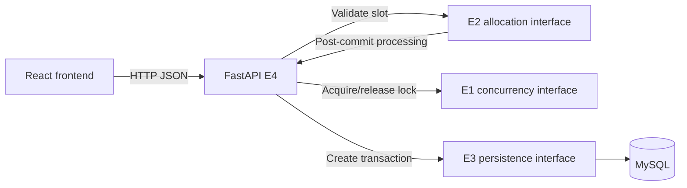

# E4 Communication Engine

## 1. Introduction

E4 is the HTTP communication and orchestration layer for the Sports Venue and Equipment Booking System. It is the browser-facing backend entry point built with FastAPI.

E4 does not implement locking, allocation, SQL, or database transactions. It calls the external E1, E2, and E3 interfaces and converts their outcomes into HTTP responses.

## 2. Architecture



E3 is the only engine allowed to access MySQL. E4 sends booking requests through the persistence port and receives the persisted booking ID through `TransactionResult`.

## 3. E4 responsibilities

- Register FastAPI routes.
- Validate incoming JSON with shared Pydantic contracts.
- Call E2 for initial booking validation.
- Call E1 to acquire the court interval lock.
- Call E3 to create and commit the booking transaction.
- Call E2 for post-commit split/merge processing.
- Always attempt lock release after lock acquisition.
- Convert engine outcomes into meaningful HTTP status codes.
- Inject external engine dependencies; never implement their behavior.

## 4. Booking workflow

1. The frontend sends a booking request.
2. FastAPI validates it against `BookingRequest`.
3. E4 calls `allocation.validate_time_slot(court_id, equipment_id, interval)`.
4. A false validation result returns HTTP `422`.
5. E4 calls `concurrency.acquire(interval, court_resource_id)`.
6. A busy or unavailable lock returns HTTP `409`.
7. E4 calls `persistence.create_booking(request)`.
8. A failed transaction returns HTTP `500`.
9. E3 must return `succeeded=True` and the actual persisted `booking_id`.
10. E4 calls E2 post-commit processing.
11. Post-commit processing failure is logged. A database-committed booking remains confirmed.
12. E4 always attempts lock release.
13. A release failure is logged and does not turn a successful commit into an uncommitted booking.
14. E4 returns HTTP `201` with the E3 booking ID.

The court and equipment IDs in the request must identify existing records. E4 never creates IDs.

## 5. E4 files

| File | Purpose |
|---|---|
| `e4_communication/coordinator.py` | Orchestrates E2, E1, E3, and post-commit processing. |
| `e4_communication/routes.py` | Exposes health and booking HTTP endpoints and maps E4 errors to HTTP responses. |
| `e4_communication/__init__.py` | Marks the E4 communication package. |
| `main.py` | Initializes FastAPI, CORS, and the router. |
| `contracts/booking.py` | Shared request, response, interval, lock, validation, and transaction contracts. |
| `contracts/interfaces.py` | Shared abstract interfaces for E1 and E2. |
| `tests/e4/test_booking.py` | E4 orchestration and HTTP tests using test doubles. |
| `tests/e4/test_health.py` | FastAPI startup and health endpoint tests. |

## 6. Important classes and functions

### `BookingCoordinator`

Coordinates the complete booking workflow. It validates engine dependency methods during construction.

### `PersistencePort`

A protocol required by E4 for E3:

- `create_booking(request: BookingRequest) -> TransactionResult`

### `BookingRejectedError`

Raised when E2 rejects the booking request.

### `BookingBusyError`

Raised when E1 cannot acquire the court interval lock.

### `BookingPersistenceError`

Raised when E3 fails or does not provide a persisted booking ID.

### `BookingDependencyError`

Raised for missing or unimplemented external engine dependencies.

## 7. API

### Health

`GET /api/health`

Successful response:

```json
{
  "status": "ok",
  "service": "sports-venue-booking"
}
```

### Create booking

`POST /api/bookings`

Request fields:

```json
{
  "court_id": "UUID",
  "equipment_id": "UUID or null",
  "date": "YYYY-MM-DD",
  "starting_time": "HH:MM",
  "ending_time": "HH:MM"
}
```

No `booking_id` or `venue_id` is accepted.

Successful response:

```json
{
  "booking_id": "UUID",
  "status": "CONFIRMED",
  "court_id": "UUID",
  "equipment_id": "UUID or null",
  "interval": {
    "start": "ISO-8601 datetime",
    "end": "ISO-8601 datetime"
  }
}
```

Intervals follow `[start, end)` and use minute precision. Overnight bookings are rejected by the current request contract.

## 8. HTTP error handling

| Situation | Status |
|---|---:|
| Invalid JSON or Pydantic field validation | `422` |
| E2 rejects the booking | `422` |
| Court interval is busy or lock fails | `409` |
| E3 persistence transaction fails | `500` |
| E3 does not return a booking ID | `500` |
| Missing or unimplemented engine dependency | `503` |
| Post-commit failure after a successful commit | Booking remains `201 CONFIRMED`; failure is logged |

Lock-release failures are logged. E4 does not claim that a lock was released if release raised an exception.

## 9. Dependency injection and startup

`app.state.booking_coordinator` is the only booking coordinator dependency used by routes.

The branch does not wire fake adapters into production. Before E1/E2/E3 implementations are injected, the application can start and serve `/api/health`, but booking requests return `503`.

Future application wiring should construct real engine service objects and assign:

```python
app.state.booking_coordinator = BookingCoordinator(
    allocation=real_e2_service,
    concurrency=real_e1_service,
    persistence=real_e3_repository,
)
```

Only E3 may perform SQLAlchemy database operations.

## 10. Run the backend

```powershell
python -m venv .venv
.venv\Scripts\Activate.ps1
python -m pip install -e ".[test]"
uvicorn app.main:app --reload --app-dir backend
```

Health endpoint:

```text
http://localhost:8000/api/health
```

Do not create or expose `.env` secrets while configuring or running the project.

## 11. Run E4 tests

With test dependencies installed:

```powershell
python -m pytest backend/tests/e4
```

Full suite:

```powershell
python -m pytest
```

The E4 tests use fake dependencies and prove E4 orchestration behavior. They do not prove real E1/E2/E3 integration or real MySQL persistence.

## 12. Implementation status

### Implemented and tested

- FastAPI router registration.
- Court-based Pydantic booking request.
- Booking validation and HTTP error mapping.
- E2/E1/E3 orchestration sequence.
- Persistence failure handling.
- Lock-release attempts.
- Optional equipment request forwarding.
- Test doubles for independent engine testing.

### Implemented but not integration-tested

- Real future E1/E2/E3 dependency wiring.
- Real engine method compatibility.
- Real MySQL persistence.

### Pending external integration

- Working E1 lock implementation.
- Working E2 validation and post-commit implementation.
- Working E3 persistence/repository implementation.
- Confirmed method signatures for all external engine services.

## 13. Known integration decisions

- Court locking currently uses `str(request.court_id)` because that is the agreed `ConcurrencyLockInterface.resource_id` parameter.
- If an optional equipment quantity or equipment resource lock is required, E1 and E4 need a coordinated interface change. E4 does not invent equipment quantity or locking rules.
- E3 must generate and return the actual booking UUID.
- E2 post-commit processing receives `TransactionResult` and must not be called as a second validation step.
- No shared contract may be changed without approval from the affected engine developers.
